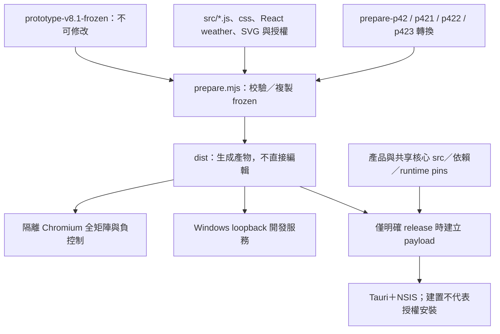

# 開發流程 P0：政策、可觀測性與基準量測

本文件保存 P0 當時的基準與計畫。2026-11-07 已完成 P1 與使用者同意的分層驗證，現況見 [改善報告](WORKFLOW-IMPROVEMENT-2026-11-07.md)；下方「待實作」屬歷史，不是目前未完成狀態。

依使用者提供的 `atmos-codex-workflow-review-2026-11-06.txt` 執行。基準 HEAD 為 `f388bcdf0ac3833a2c1c926f1895c3ebbf01620b`；量測含未提交的資訊元件修正及 P0 儀表化，使用工作區內容指紋識別，並非只看 commit。

## 已完成

- 日常修改與 release 分開，記錄在 DEVELOPMENT.md 與 AGENTS.md；完整 verify 政策未降低。未安裝、未變更真實設定、未推送。
- verify、layout、installer 呼叫改為非同步串流 runner：stdout/stderr 即時向上傳遞，原始 bytes 留本機；取得 close 後才結算退出狀態。
- 階段開始／完成、實際 elapsedMs、timeout／中斷、來源指紋、Node／Python/Pillow／browser／bundler 摘要與目前不使用快取的狀態。
- 正向每 viewport 與負控制可即時見進度。完成紀錄原子取代；開始與失敗不能留下舊 green。驗證期間來源改變則整體失敗。
- 子程序 timeout／abort 只處理本次建立的程序樹；新增 Windows descendant 清理測試，不依程序名稱掃殺。
- frontend-only 的 `--reuse-payload` 暫時明確拒絕，直到完整 input/output manifest 的 P1 驗收完成。正常 installer 入口仍保留完整 gate。

## 量測條件與界線

完整 verify 連跑兩輪，固定工作區來源指紋與工具，逐案例建立隔離 Chromium profile／store；沒有清空 OS 或 browser binary cache，故第一輪不是嚴格冷快取，第二輪只稱連續暖環境觀察。目前沒有導入 orchestrator 快取。

計時涵蓋完整驗證各階段與其子程序；頂層 elapsedMs 自工具資訊預檢完成後開始，非包含 shell／Node 啟動時間的端到端量測。各階段使用 monotonic clock，不能拿 timeout 或 virtual-time-budget 相乘當時間。

首次未儀表化的打包在收到新政策前已啟動；政策到達後沒有執行 installer，未使用此檔修改設定。未部署的 0.7.33 安裝檔已刪除，版本回復已安裝的 0.7.32。這次不為測速再次打包／安裝；payload、Tauri 與 NSIS 沒有獨立 baseline，標記未量測。現行 builder 提供 payload 與合併 Tauri＋NSIS 計時入口，尚不能拆成兩個實測數字。

量測摘要見 `../evidence/workflow-p0-measurement-2026-11-06.json`。沒有儀表化前的固定條件對照，不宣稱加速倍數。本階段改進為可觀測性與政策，尚未減少 prepare／layout 次數。

## 實際量測結果

兩輪完整 verify 分別 **166.652 秒／167.536 秒**，來源指紋相同。每輪產品測試 503 項（500 通過、3 個既有 skip），核心 43 項（41 通過、2 個既有 skip），完整排版與負控制均通過。12 viewport、336 元件／主題、1008 feed、1008 資訊模板、336 省電、336 YouTube、720 天氣案例保持完整。

| 階段 | 兩輪平均 | 占平均完整流程 |
| --- | ---: | ---: |
| 完整排版 gate | 139.326 秒 | 83.38% |
| 產品測試 | 11.137 秒 | 6.66% |
| 核心測試 | 7.825 秒 | 4.68% |

此為非重疊頂層階段的前三大，沒有再把包含於 gate 的 viewport 耗時重複加總。每輪仍 prepare 兩次、layout 一次；同次 release 會額外重跑 gate 的問題尚待 P1。prepare 本身約半秒一次，不能因呼叫次數多就斷言它是最大瓶頸。

## 最小 P1 計畫與預計檔案

先同一次流程內去重，不先做跨次快取：

| 檔案 | 目的 |
| --- | --- |
| `implementation-p4_2_5/scripts/frontend-artifact.mjs`（新增） | 建立唯一 artifact，固定輸入清單、工具／依賴／flags 與輸出完整 bytes，拒絕 symlink／新增／遺失／同大小修改 |
| `implementation-p4_2_5/scripts/workflow.mjs`（新增） | 單次 orchestrator；私有流程證明，不能信任任意磁碟 `passed:true`；release 明確 opt-in |
| `implementation-p4_2_5/scripts/verify.mjs`、`verify-layout.mjs` | 共用 artifact；完整 tests、負控制與矩陣各跑一次；獨立入口仍建立並驗證 |
| `desktop-host/scripts/build-installer.mjs`、`prepare-payload.mjs` | 封裝已驗 bytes，不能重 prepare 另一份；來源改變則拒絕／重驗，不自動安裝 |
| `desktop-host/scripts/verify-reused-payload.mjs` | 完整 payload input/output manifest，涵蓋後端、共享核心、凍結來源、依賴、runtime／授權、來源 manifest 與工具；P1 驗收前不恢復 flag |
| `implementation-p4_2_5/tests/*workflow*`、`*payload*` | 依審查文件 12 項驗收逐一涵蓋呼叫次數、失效、篡改、缺瀏覽器、timeout／中斷、負控制與 smoke 不能授權 release |

P1／P2／P3 都在 TODO，以未完成標記。未宣稱已安全去重、已實作完整 payload manifest 或已完成 HMR 驗證。

## 現行來源路徑

此圖只定位維護入口；尚未逐個 replace 錨點重構。P3 先補恰好一次替換斷言，再小路徑整理，不碰 frozen 或來源 provenance。
