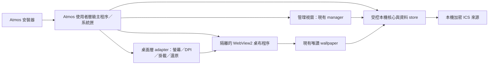

# Lively 功能盤點與 Atmos 獨立桌布宿主規劃

盤點日期：2026-11-03。來源為官方 `lively-community/lively` 的 `core-separation`，固定 commit [`25a0a5f4ed1988ff42117d3a17feb321062237fe`](https://github.com/lively-community/lively/tree/25a0a5f4ed1988ff42117d3a17feb321062237fe)。本次閱讀功能說明與原始碼，**沒有複製 Lively 實作到 Atmos，也沒有安裝或啟動新的原生桌布宿主**。

## 需求、目的、限制

目標是讓使用者安裝 Atmos 後，由 Atmos 自己啟動、呈現並套用動態桌布，不必安裝／操作 Lively。保留目前管理網頁、唯讀 renderer、設定交易與 ICS 日曆；新增 Windows 原生桌布層及安裝／生命週期管理。

網站、PWA 或無邊框視窗都不會自然成為 Windows 桌布。官方 `IDesktopWallpaper.SetWallpaper` 的輸入是圖片檔案路徑；要讓目前的 HTML／Canvas 成為圖示後方的動態桌布，還需要原生視窗與桌面層整合。[Microsoft 圖片桌布 API](https://learn.microsoft.com/en-us/windows/win32/api/shobjidl_core/nf-shobjidl_core-idesktopwallpaper-setwallpaper)

這次先完成排版實測、原始碼盤點與可執行的開發規劃；不把它標成已完成安裝即套用。桌布宿主需要在登入使用者的互動 session 運作，不能把一般 Session 0 Windows Service 當成可直接顯示桌布的程序。[Microsoft Interactive Services](https://learn.microsoft.com/en-us/windows/win32/services/interactive-services)

## Lively 有哪些功能

| 類別 | Lively 的能力 | 原始碼依據 | Atmos 的優先級 |
| --- | --- | --- | --- |
| 網頁桌布 | HTML／網頁、互動與 Chromium／WebView2 播放器 | [WallpaperPluginFactory](https://github.com/lively-community/lively/blob/25a0a5f4ed1988ff42117d3a17feb321062237fe/src/Lively/Lively/Factories/WallpaperPluginFactory.cs)、[WebWebView2](https://github.com/lively-community/lively/blob/25a0a5f4ed1988ff42117d3a17feb321062237fe/src/Lively/Lively/Core/Wallpapers/WebWebView2.cs) | P0：只承載 Atmos 自有唯讀頁 |
| 原生桌面掛載 | 找出桌面層、設定父視窗與 Z-order，適配不同 Shell 結構 | [WinDesktopCore.SetupDesktopLayer／TryAttachToDesktop](https://github.com/lively-community/lively/blob/25a0a5f4ed1988ff42117d3a17feb321062237fe/src/Lively/Lively/Core/WinDesktopCore.cs#L147-L238) | P0：獨立宿主最核心的缺口 |
| 影片／GIF | 硬體加速影片與其他播放器選擇 | [播放器工廠](https://github.com/lively-community/lively/blob/25a0a5f4ed1988ff42117d3a17feb321062237fe/src/Lively/Lively/Factories/WallpaperPluginFactory.cs) | P2：首版不必同時做完整影片引擎 |
| 外部程式桌布 | 可把應用程式／遊戲作為桌布 | [官方功能清單](https://github.com/lively-community/lively/blob/25a0a5f4ed1988ff42117d3a17feb321062237fe/README.md) | P2：先不允許任意執行外部程式 |
| 多螢幕 | 單螢幕配置、跨螢幕、複製，顯示裝置變更與幾何更新 | [DisplayManager](https://github.com/lively-community/lively/blob/25a0a5f4ed1988ff42117d3a17feb321062237fe/src/Lively/Lively/Core/Display/DisplayManager.cs)、WinDesktopCore 的版面保存／還原 | P0 先單主螢幕；P1 多螢幕與 DPI |
| 自動暫停 | 前景／全螢幕、視窗覆蓋、個別應用規則 | [Playback](https://github.com/lively-community/lively/blob/25a0a5f4ed1988ff42117d3a17feb321062237fe/src/Lively/Lively/Core/Suspend/Playback.cs) | P1：避免全螢幕遊戲仍持續渲染 |
| 系統狀態節能 | 鎖屏、遠端桌面、電池與省電模式等暫停判斷 | [Playback.IsPauseDueToSystemState](https://github.com/lively-community/lively/blob/25a0a5f4ed1988ff42117d3a17feb321062237fe/src/Lively/Lively/Core/Suspend/Playback.cs#L400-L425) | P1：必須明確報告暫停原因 |
| Shell／解鎖恢復 | Explorer 重啟、桌面 handle 失效、解鎖後重新掛載 | [WinDesktopCore](https://github.com/lively-community/lively/blob/25a0a5f4ed1988ff42117d3a17feb321062237fe/src/Lively/Lively/Core/WinDesktopCore.cs#L1037-L1156) | P0／P1：不能只做一次 SetParent |
| 播放器生命週期 | 媒體播放／暫停、頁面恢復、子程序失敗處理 | [WebView2 Form1](https://github.com/lively-community/lively/blob/25a0a5f4ed1988ff42117d3a17feb321062237fe/src/Lively/Lively.Player.WebView2/Form1.cs) | P0 隔離程序；P1 節能策略 |
| 崩潰清理 | Watchdog 追蹤父程序與被管理程序 | [Watchdog](https://github.com/lively-community/lively/blob/25a0a5f4ed1988ff42117d3a17feb321062237fe/src/Lively/Lively.Utility.Watchdog/Program.cs) | P0：只清理自己建立的程序 |
| 桌布庫／屬性 | 匯入、預覽、縮圖、可調桌布屬性 | [WallpaperLibraryFactory](https://github.com/lively-community/lively/blob/25a0a5f4ed1988ff42117d3a17feb321062237fe/src/Lively/Lively.Common/Factories/WallpaperLibraryFactory.cs)、LibraryViewModel | P0 沿用現有場景；P2 擴充套件 |
| 自動化／IPC | CLI 與 gRPC 的設定、關閉、事件訂閱、截圖等操作 | [wallpaper.proto](https://github.com/lively-community/lively/blob/25a0a5f4ed1988ff42117d3a17feb321062237fe/src/Lively/Lively.Grpc.Common/Proto/wallpaper.proto) | P0 最小本機通道，P1 擴充 |
| 真實系統資料 | 硬體用量、音訊視覺化、Now Playing 等服務 | [HardwareUsageService](https://github.com/lively-community/lively/blob/25a0a5f4ed1988ff42117d3a17feb321062237fe/src/Lively/Lively.Common.Services/HardwareUsageService.cs)、[服務目錄](https://github.com/lively-community/lively/tree/25a0a5f4ed1988ff42117d3a17feb321062237fe/src/Lively/Lively.Common.Services) | P2：目前 Atmos 對應卡片仍為 demo／N/A |
| 螢幕保護程式 | 單獨的 screensaver 流程與多螢幕支援 | [Screensavers service](https://github.com/lively-community/lively/blob/25a0a5f4ed1988ff42117d3a17feb321062237fe/src/Lively/Lively/Services/ScreensaverService.cs) | P2，不等同 Windows 安全鎖定畫面 |
| 深度動態效果 | 機器學習深度估計相關功能 | [DepthEstimate](https://github.com/lively-community/lively/tree/25a0a5f4ed1988ff42117d3a17feb321062237fe/src/Lively/Lively.ML/DepthEstimate) | P2，非獨立套用桌布的先決條件 |
| 安裝與登入啟動 | 安裝器、使用者層級設定及 StartupTask／登入啟動分支 | [Installer](https://github.com/lively-community/lively/blob/25a0a5f4ed1988ff42117d3a17feb321062237fe/src/installer/Script_x64.iss)、[WindowsStartup](https://github.com/lively-community/lively/blob/25a0a5f4ed1988ff42117d3a17feb321062237fe/src/Lively/Lively/Helpers/WindowsStartup.cs) | P0 安裝及首次套用；P1 登入自啟與更新 |

## 最重要的程式碼觀察

Lively 的桌面核心會探測不同 Progman／WorkerW／Shell view 結構，再決定視窗父層、樣式及層級；它不是一段通用的「最底層視窗」設定。其 Shell 整合包含非穩定公開合約的行為，Atmos 需要自己的版本探測、失敗處理與 Windows 實機測試，不應照抄某個固定 WorkerW 排序。

Microsoft 的 SetParent 文件也指出不同 DPI awareness 會造成錯誤或非預期行為，並且不會自動替程式修正 WS_CHILD／WS_POPUP。這是原生宿主的工程工作，現有前端的預覽比例正確不代表它已解決。[SetParent 文件](https://learn.microsoft.com/en-us/windows/win32/api/winuser/nf-winuser-setparent)

Lively WebView2 的部分渲染暫停涉及其特定子程序處理方式。Atmos 應先採明確的播放狀態協定與受支援的 WebView2 生命週期能力，對停止動畫、媒體、同步輪詢及 GPU 效果分別量測；不直接移植特定 Chromium 子程序／debugger 技巧。

## 建議的 Atmos 架構

可走的路有兩條：

| 路線 | 好處 | 代價 |
| --- | --- | --- |
| 以 Lively 為基底整合自己的 UI | 可沿用其既有桌面／播放器處理，不需要使用者另開 Lively 產品 | 需先決定 GPL 相容的發佈方式；仍須拆解與整合其設定、程序、UI 及相依套件，並非單純改名 |
| 自己寫只服務 Atmos 的宿主 | 可保留目前產品分工，首版功能集中；不必重做所有外部媒體能力 | 自己承擔 Shell、DPI、恢復與資源測試；尚無真宿主之前不可承諾能安裝即用 |

建議首版採 **C# Windows 使用者層級宿主＋WebView2＋現有 Atmos 本機核心**，先以 Windows 11 x64、單主螢幕交付為目標。這是本次評估的建議，尚未實作的模組不可列為已具備。

每個 native HWND、子程序、通訊 session 都記錄 owner。管理頁保持寫入能力，桌布頁只讀與回報；不把 host object 或任意本機執行能力暴露給網頁。IPC 使用者／session 隔離並驗證訊息，而不是只憑固定 port 或程序名稱信任另一端。

原生狀態需區分 `shellAttached`、`rendererReady`、`pausedReason`、`lastPresentedAt`，並附上顯示器 ID／DPI／程序身分。收到 renderer ack 不等於已在桌面正確呈現；失去 Shell handle 後應撤銷 attached 狀態並復原，不能沿用舊成功值。

WebView2 有獨立 Runtime 發佈要求；安裝器要檢查並處理缺少的 Runtime，不能把有 Edge 瀏覽器當作已符合條件。[Microsoft Runtime 發佈文件](https://learn.microsoft.com/en-us/microsoft-edge/webview2/concepts/distribution)

現有核心仍依賴 Node 和 Python/Pillow。首個獨立安裝版應隨產品封裝經驗證的相依執行環境，以維持目前圖片驗證／正規化行為，不要求一般使用者手動裝開發工具；後續才評估以原生影像 adapter 替換 Python，並另做格式、尺寸、雜湊及既有資產相容測試。

## 分階段實作與驗收

| 階段 | 具體交付 | 必須能證明的結果 |
| --- | --- | --- |
| P0a 宿主骨架 | 使用者 session 的主程序、單實例、系統匣、獨立 manager 與 renderer、受控核心啟停 | 關掉管理視窗仍可運作；退出後無自有孤兒程序；不啟動 Lively |
| P0b 真桌面掛載 | 桌面結構探測、owner 記錄、單主螢幕掛載、失敗還原 | 圖示操作正常、不搶焦點、不蓋任務列；附著失敗可返回原桌布 |
| P0c 安裝即用 | 自包含安裝包、Runtime 檢查、初始資料、完成安裝後啟動並套用 Atmos | 在沒有 Lively／Node／Python 開發環境的乾淨 Windows 帳號驗證，不靠現有開發機服務 |
| P1 穩定性 | 螢幕熱插拔、多螢幕／DPI、Explorer 重啟、WebView／核心故障復原、鎖屏／真睡眠恢復 | 每個情境有原生事件與實際畫面／回報證據；受硬體限制時明確列未驗證 |
| P1 節能與使用體驗 | 全螢幕／電池／遠端暫停、登入自啟、可逆卸載、更新／回復 | 完整兩小時以上的 CPU／GPU／記憶體／handle 測試；暖機後判讀趨勢，不只看整機 CPU 百分比 |
| P2 擴充 | 真系統資料、Now Playing、影片、桌布庫、screensaver、ML 等 | 依實際需要逐項納入，不讓替代宿主的首版變成重做整個 Lively |

「安裝後首次套用」與「每次登入 Windows 自動啟動」應是分開且清楚的產品設定。首次套用前保存可還原的狀態，處理現有桌布宿主的衝突；不以終止所有 Lively／Node 程序解決。卸載或退出只處理 Atmos 自己建立的資源，保留私人日曆資料的清除選項。

本機之前的 36 分鐘部分耗用測試已有 private bytes／handles 增長，尚未證明收斂；本環境又不支援 S0／S3 真睡眠。兩者都不能因為改成自有宿主就自動視為解決，必須在後續穩定性階段重測。

## 授權限制

Lively 專案標示 GPL v3。若直接採用、修改並散布其受 GPL 涵蓋的程式碼，需要處理 GPL 授權、適當告知與對應來源提供等義務；不能把「包進 Atmos」當作授權不再適用。詳見官方 [LICENSE](https://github.com/lively-community/lively/blob/25a0a5f4ed1988ff42117d3a17feb321062237fe/LICENSE)。

目前採取的路線是閱讀功能與分工、另行設計 Atmos 介面與宿主，不複製 GPL 原始碼、不改動本倉庫整體授權。WebView2、.NET、Node、Python/Pillow 及其他相依套件仍各自需要發佈與授權檢查；正式選擇以 Lively 為基底前，應先決定產品可接受的散布模式。
